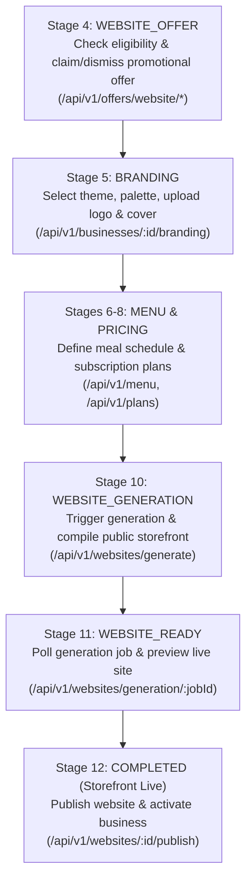
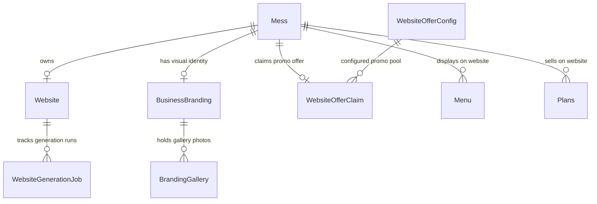
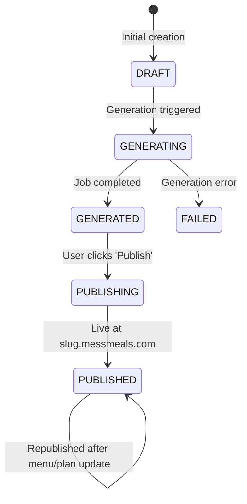
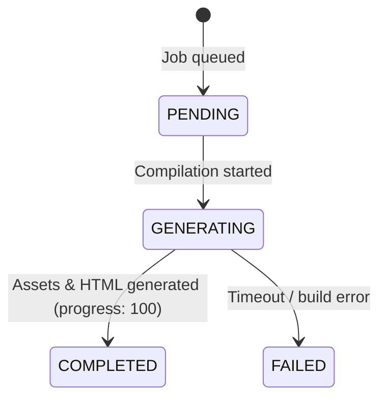

# Onboarding Website Feature — Comprehensive Implementation Plan & Integration Guide

> This document details the **already existing Onboarding Website Feature** in the MessMeals backend, its domain models, API surfaces, lifecycle state machines, frontend integration patterns, and necessary backend alignment fixes.

---

## 1. Feature Overview & Architecture

The **Onboarding Website Feature** enables mess owners (food business admins) to build, brand, generate, preview, and publish a dedicated public web storefront (`https://<slug>.messmeals.com` or custom domain) directly within the onboarding wizard.

### Core Workflow Phases



---

## 2. Database Models & Schema Relationships

The website feature spans 6 tightly coupled Prisma models:



### Entity Schema Summary

| Model | Table Name | Purpose | Key Attributes |
|---|---|---|---|
| `Website` | `websites` | The public storefront entity | `id`, `messId` (unique), `slug` (unique), `websiteUrl`, `status` (`WebsiteStatus`), `publishedAt` |
| `WebsiteGenerationJob` | `website_generation_jobs` | Tracks async website generation lifecycle | `id`, `websiteId`, `status` (`GenerationJobStatus`), `attempt`, `errorMessage`, `startedAt`, `completedAt` |
| `WebsiteOfferConfig` | `website_offer_configs` | Global promotional offer pool (e.g. 200 free websites) | `id`, `maxClaims`, `originalPrice`, `promoPrice`, `isEnabled`, `totalClaimed` |
| `WebsiteOfferClaim` | `website_offer_claims` | Tracks whether a mess claimed or dismissed the offer | `id`, `userId`, `messId` (unique), `configId`, `status` (`OfferClaimStatus`), `claimedAt` |
| `BusinessBranding` | `business_brandings` | The visual theme and colors of the mess | `id`, `messId` (unique), `displayName`, `theme` (`WebsiteTheme`), `primaryColor`, `secondaryColor`, `logoUrl`, `coverUrl` |
| `OnboardingSession` | `onboarding_sessions` | Wizard state machine progress | `id`, `userId`, `messId`, `currentStage` (`OnboardingStage`), `completedStages`, `status` |

---

## 3. State Machines & Status Transitions

### A. Website Status (`WebsiteStatus`)


### B. Generation Job Status (`GenerationJobStatus`)


### C. Promotional Offer Status (`OfferClaimStatus`)
- `AVAILABLE` (Virtual / uncommitted): Spots remain in `WebsiteOfferConfig` and mess has not claimed or dismissed.
- `CLAIMED`: Discount locked in (promo price ₹0), counter incremented.
- `DISMISSED`: User opted out of the free website promo.

---

## 4. End-to-End API Reference

### Phase 1: Promotional Website Offer (`WEBSITE_OFFER`)

#### 1. Check Offer Eligibility
- **Endpoint:** `GET /api/v1/offers/website/eligibility`
- **Query:** `?messId=<uuid>` (optional)
- **Auth:** `Bearer <JWT>` (`MESSADMIN`, `SUPERADMIN`)
- **Response (200 OK):**
```json
{
  "success": true,
  "message": "Offer eligibility retrieved",
  "data": {
    "isEligible": true,
    "status": "AVAILABLE",
    "spotsRemaining": 194,
    "maxClaims": 200,
    "totalClaimed": 6,
    "originalPrice": 9999,
    "promoPrice": 0,
    "currency": "INR",
    "savings": 9999
  }
}
```

#### 2. Claim Promotional Offer
- **Endpoint:** `POST /api/v1/offers/website/claim`
- **Body:** `{ "messId": "<uuid>" }`
- **Behavior:** Locks in ₹0 pricing, atomically increments `totalClaimed`, advances onboarding session to `WEBSITE_OFFER`.

#### 3. Dismiss Promotional Offer
- **Endpoint:** `POST /api/v1/offers/website/dismiss`
- **Body:** `{ "messId": "<uuid>" }`
- **Behavior:** Records status as `DISMISSED`, advances onboarding session to `WEBSITE_OFFER`.

---

### Phase 2: Branding & Visual Theme (`BRANDING`)

#### 1. Get Branding Settings
- **Endpoint:** `GET /api/v1/businesses/:id/branding`
- **Response (200 OK):**
```json
{
  "success": true,
  "data": {
    "id": "branding-uuid",
    "messId": "mess-uuid",
    "displayName": "Annapoorna Mess",
    "theme": "WARM",
    "primaryColor": "#FF5722",
    "secondaryColor": "#33C1FF",
    "logoUrl": "https://cdn.messmeals.com/logos/mess-1.png",
    "coverUrl": "https://cdn.messmeals.com/covers/mess-1.jpg",
    "galleryItems": []
  }
}
```

#### 2. Update Branding Settings
- **Endpoint:** `PUT /api/v1/businesses/:id/branding`
- **Body:**
```json
{
  "displayName": "Annapoorna Kitchen",
  "theme": "WARM",
  "primaryColor": "#FF5722",
  "secondaryColor": "#FFE082",
  "logoUrl": "https://s3.amazonaws.com/.../logo.png",
  "coverUrl": "https://s3.amazonaws.com/.../cover.jpg"
}
```
> Supported `theme` enum values: `DEFAULT`, `WARM`, `COOL`, `EARTHY`, `VIBRANT`, `MINIMAL`, `CUSTOM`.

---

### Phase 3: Website Generation (`WEBSITE_GENERATION`)

#### 1. Trigger Website Generation
- **Endpoint:** `POST /api/v1/websites/generate`
- **Body:**
```json
{
  "messId": "2d9ba720-63cf-4c41-bdcd-6711986a0343",
  "theme": "WARM",
  "customDomain": "annapoorna.messmeals.com"
}
```
*(All body fields are optional — will default to mess's slug: `https://<slug>.messmeals.com`)*
- **Response (201 Created):**
```json
{
  "success": true,
  "message": "Website generated successfully",
  "data": {
    "jobId": "8f31b2c4-8742-4211-9a74-b96e571dbb14",
    "websiteId": "1b5821c9-768a-4428-b2ef-379f886f4b66",
    "status": "COMPLETED",
    "slug": "annapoorna-pure-veg-mess",
    "websiteUrl": "https://annapoorna-pure-veg-mess.messmeals.com",
    "previewUrl": "https://annapoorna-pure-veg-mess.messmeals.com?preview=true",
    "generatedAt": "2026-11-09T08:15:00.000Z"
  }
}
```

#### 2. Poll Website Generation Job Status
- **Endpoint:** `GET /api/v1/websites/generation/:jobId`
- **Response (200 OK):**
```json
{
  "success": true,
  "message": "Generation job status retrieved",
  "data": {
    "jobId": "8f31b2c4-8742-4211-9a74-b96e571dbb14",
    "websiteId": "1b5821c9-768a-4428-b2ef-379f886f4b66",
    "status": "COMPLETED",
    "progress": 100,
    "slug": "annapoorna-pure-veg-mess",
    "websiteUrl": "https://annapoorna-pure-veg-mess.messmeals.com",
    "previewUrl": "https://annapoorna-pure-veg-mess.messmeals.com?preview=true",
    "startedAt": "2026-11-09T08:15:00.000Z",
    "completedAt": "2026-11-09T08:15:01.000Z"
  }
}
```

---

### Phase 4: Preview & Storefront Launch (`WEBSITE_READY` & `COMPLETED`)

#### 1. Fetch Current Business Website Details
- **Endpoint:** `GET /api/v1/websites/me`
- **Response (200 OK):** Returns the website record, slug, domain, published timestamp, and attached mess details.

#### 2. Publish Website Live
- **Endpoint:** `POST /api/v1/websites/:id/publish`
- **Response (200 OK):**
```json
{
  "success": true,
  "message": "Website published successfully! Your online storefront is live.",
  "data": {
    "id": "1b5821c9-768a-4428-b2ef-379f886f4b66",
    "messId": "2d9ba720-63cf-4c41-bdcd-6711986a0343",
    "slug": "annapoorna-pure-veg-mess",
    "websiteUrl": "https://annapoorna-pure-veg-mess.messmeals.com",
    "status": "PUBLISHED",
    "publishedAt": "2026-11-09T08:20:00.000Z"
  }
}
```

#### 3. Republish Website (After Updating Menus or Plans)
- **Endpoint:** `POST /api/v1/websites/:id/republish`
- **Response (200 OK):** Updates cache and stamps `updatedAt` with latest active plans & weekly menus.

#### 4. Finalize Onboarding & Business Activation
- **Endpoint:** `POST /api/v1/onboarding/complete`
- **Response (200 OK):** Marks `OnboardingSession` as `COMPLETED`, sets `Mess.is_active = true`, activating the mess across customer mobile apps and web discovery.

---

### Phase 5: Public Storefront Consumer Endpoint

Once published, the public storefront renders from the Open API surface:
- **Endpoint:** `GET /open/mess/:slug`
- **Auth:** Public (Unauthenticated)
- **Data returned:**
  - Mess details (`name`, `description`, `address`, `phone`, `email`, `openingHours`)
  - Full branding (`theme`, `primaryColor`, `secondaryColor`, `logoUrl`, `coverUrl`, `galleryItems`)
  - Active subscription plans (`Plans[]` with prices, schedules, and available days)
  - Active weekly meal menus (`Menu[]` with daily dish breakdowns)
  - Verified customer testimonials & ratings

---

## 5. Integration with the Unified Onboarding API

The unified onboarding endpoints introduced earlier support this workflow:

1. **`POST /api/v1/onboarding/data`**:
   - Allows saving `branding` and claiming `offer` in the unified body:
   ```json
   {
     "branding": {
       "displayName": "Annapoorna Kitchen",
       "theme": "WARM",
       "primaryColor": "#FF5722"
     },
     "offer": {
       "claim": true
     }
   }
   ```
2. **`GET /api/v1/onboarding/session`**:
   - Hydrates `stageData.branding` and `stageData.offer`.
   - Computes `stageCompletion.WEBSITE_OFFER`, `stageCompletion.BRANDING`, `stageCompletion.WEBSITE_GENERATION`, and `stageCompletion.COMPLETED`.

---

## 6. Frontend Step-by-Step Implementation Guide

### Screen 1: Website Promotional Offer (`/onboarding/offer`)
1. **On Mount:** Call `GET /api/v1/offers/website/eligibility`.
2. **Render UI:**
   - Hero banner: *"Claim your free branded website (₹0 instead of ₹9,999)"*.
   - Counter: *"Only {spotsRemaining} spots left out of {maxClaims}"*.
3. **User Action:**
   - **Click "Claim Free Website":** Call `POST /api/v1/offers/website/claim` -> on success, route to Branding.
   - **Click "Skip for Now":** Call `POST /api/v1/offers/website/dismiss` -> route to Branding.

---

### Screen 2: Visual Branding & Theme (`/onboarding/branding`)
1. **Inputs:**
   - Display name input.
   - Theme selector cards: `DEFAULT`, `WARM`, `COOL`, `EARTHY`, `VIBRANT`, `MINIMAL`.
   - Primary & Secondary color pickers (presets + hex input).
   - Logo uploader (drag & drop to S3 presigned URL).
   - Cover banner uploader.
2. **Action:**
   - Save via `PUT /api/v1/businesses/:id/branding` (or `POST /api/v1/onboarding/data`).
   - Proceed to Menu Setup.

---

### Screen 3: Website Generation & Live Preview (`/onboarding/website`)
1. **Trigger Generation:**
   - Display summary of business, location, menus, and plans.
   - Button: **"Generate My Website"**.
   - On click: Call `POST /api/v1/websites/generate`.
2. **Progress & Polling:**
   - Show progress bar / animated generation checklist:
     - *Validating meal schedules...*
     - *Applying brand theme & colors...*
     - *Deploying storefront subdomain...*
   - Poll `GET /api/v1/websites/generation/:jobId` every 1.5 seconds until `status === 'COMPLETED'`.
3. **Interactive Preview (`WEBSITE_READY`):**
   - Render preview in an embedded responsive container (`iframe` pointing to `previewUrl` or mocked component using `GET /open/mess/:slug`).
   - Allow switching viewport: Desktop / Mobile preview.
   - Provide "Edit Menu/Plans" button if revisions are needed.

---

### Screen 4: Final Launch & Completion (`/onboarding/launch`)
1. **User Action:**
   - Button: **"Launch Storefront Live"**.
   - Step 1: Call `POST /api/v1/websites/:id/publish`.
   - Step 2: Call `POST /api/v1/onboarding/complete`.
2. **Success Screen:**
   - Confetti animation.
   - Live URL display: `https://<slug>.messmeals.com` with one-click copy and "Visit Storefront" link.
   - QR code for customer sharing and table stands.
   - Button: **"Go to Admin Dashboard"**.

---

## 7. Recommended Backend Alignment Fix

In `src/websites/websites.service.ts`:
Line 201 calls: `await this.advanceOnboarding(user.id, website.messId, 'REVIEW_LAUNCH');`
However, `OnboardingStage` enum in `prisma/schema.prisma` defines:
```prisma
enum OnboardingStage {
  PHONE_VERIFICATION
  BUSINESS_DETAILS
  LOCATION
  WEBSITE_OFFER
  BRANDING
  MENU_DAYS
  DAILY_DISHES
  PRICING
  AVAILABILITY
  WEBSITE_GENERATION
  WEBSITE_READY
  COMPLETED
}
```
`'REVIEW_LAUNCH'` is an invalid enum value and should be aligned to `OnboardingStage.WEBSITE_READY` or `OnboardingStage.COMPLETED`.

### Fix Diff for `src/websites/websites.service.ts`:
```diff
- await this.advanceOnboarding(user.id, website.messId, 'REVIEW_LAUNCH');
+ await this.advanceOnboarding(user.id, website.messId, 'COMPLETED');
```

---

## 8. Summary Checklist for Frontend & QA Teams

- [ ] **Offer Screen:** Handles zero remaining spots gracefully (disables "Claim" button, shows "Offer Closed").
- [ ] **Branding Screen:** Color pickers validate hex codes; theme preview updates in real-time.
- [ ] **Generation Screen:** Handles job failure with retry button (`POST /api/v1/websites/generate`).
- [ ] **Preview Screen:** Responsive iframe toggles between mobile viewport (375px) and desktop (100%).
- [ ] **Publish Flow:** Checks that `POST /publish` transitions website status to `PUBLISHED` and sets `Mess.is_active = true`.
- [ ] **Public View:** Verifies `GET /open/mess/:slug` loads public data with active plans and dishes.

